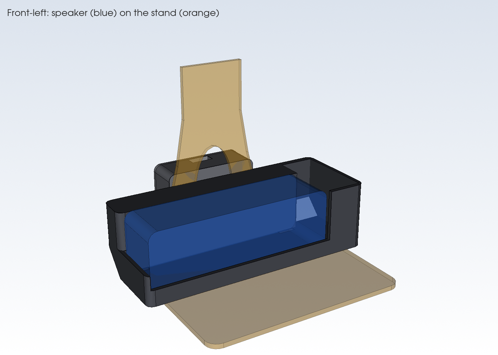
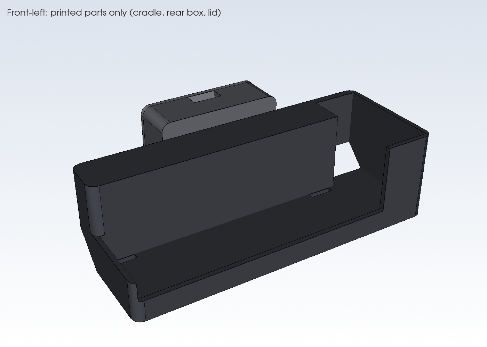
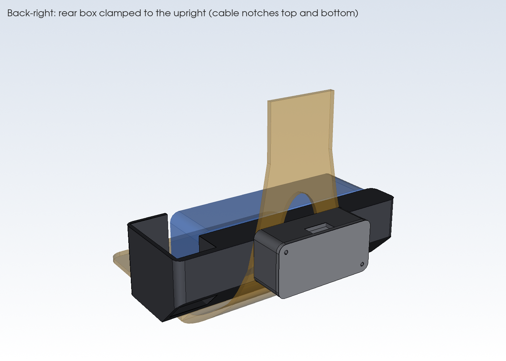
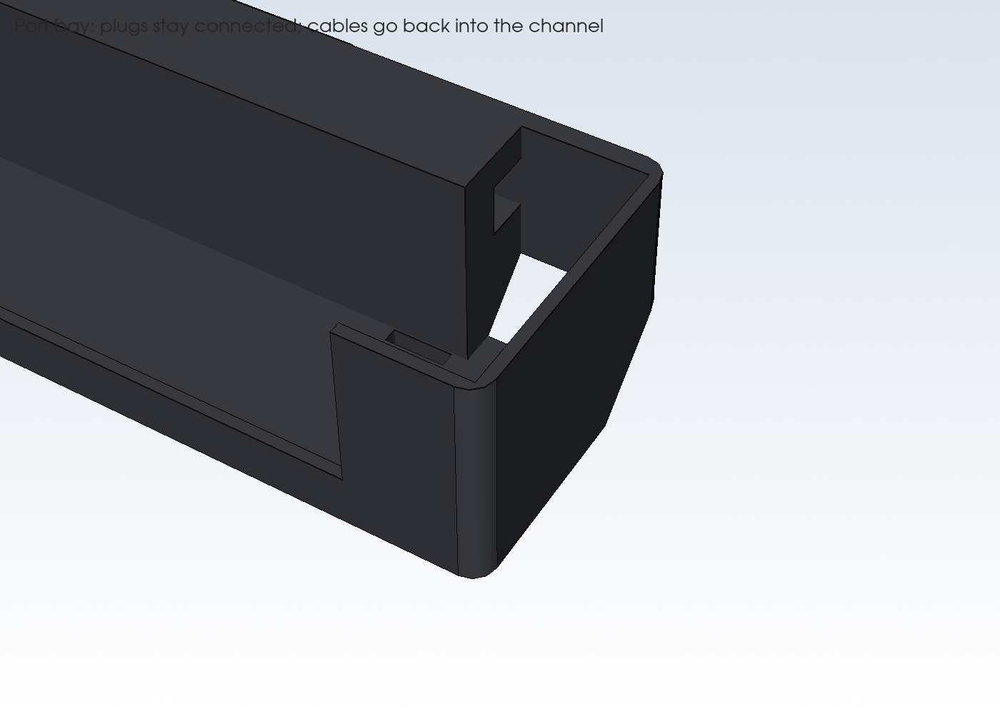
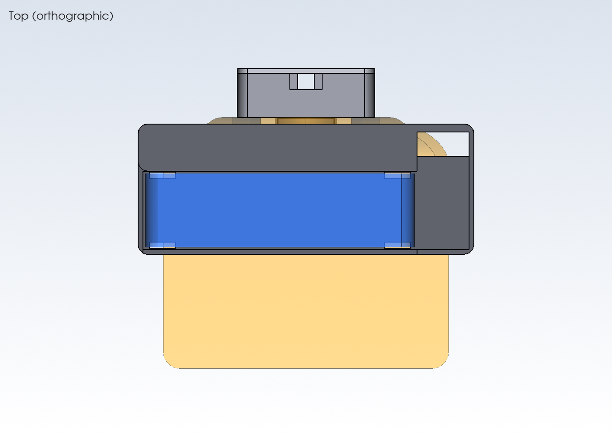
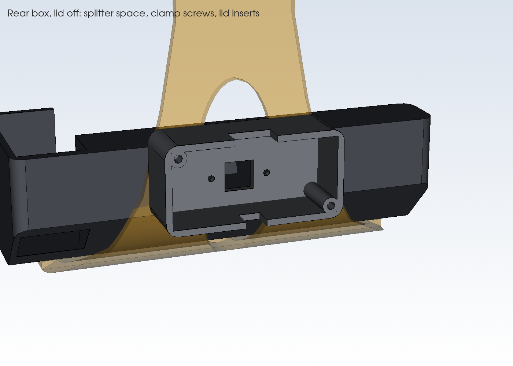
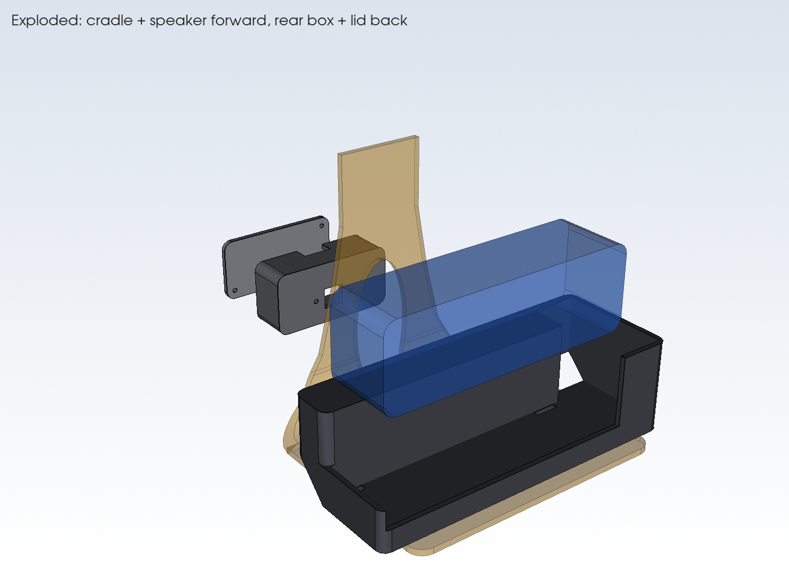
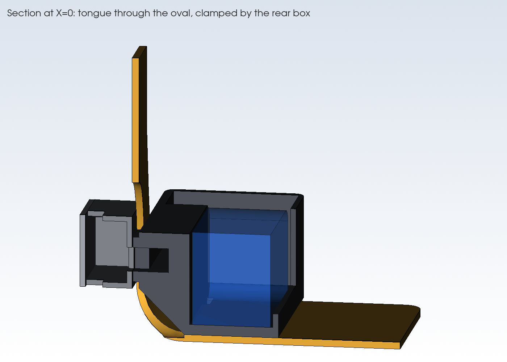
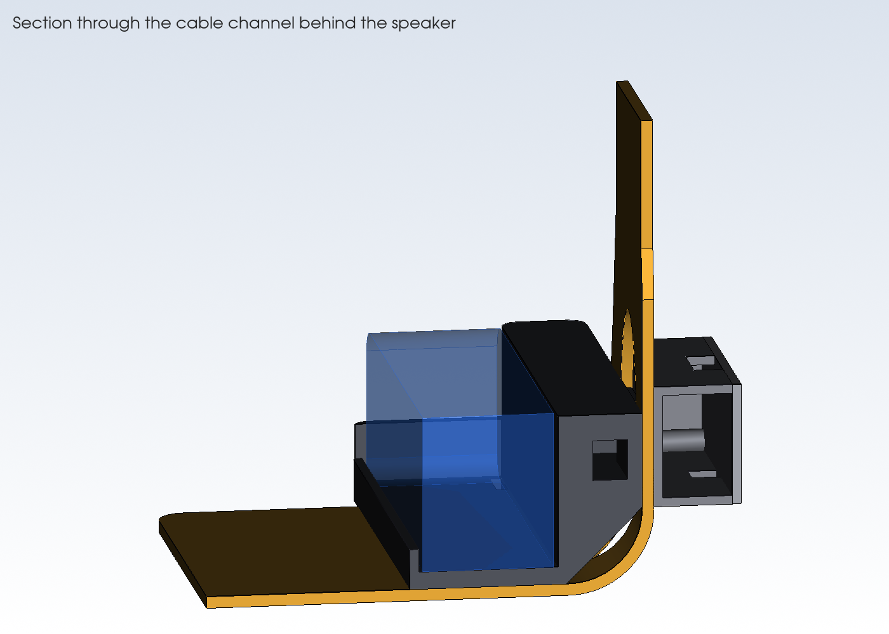

# Kiosk Speaker Cradle

A clamp-on speaker cradle for the AboveTEK countertop tablet stand. An Anker Soundcore 2 sits in a cradle on the front of the stand's base plate, below the tablet, with the grille facing the customer. A tongue on the back of the cradle passes through the oval cutout in the stand's upright. It is screwed to a small rear box on the staff side with security Torx screws, so the steel plate is clamped between the two parts and they can't be separated without the driver bit.

The speaker's USB and AUX cables stay plugged in. They run from an enclosed port bay, through a channel behind the speaker, and through the tongue into the rear box, which hides a USB splitter. One charging cable comes out of the rear box.

## Files (`output/`)
| File | Use |
|---|---|
| `cradle.step` / `.stl` | Speaker cradle with the port bay, cable channel, and clamp tongue |
| `rear_box.step` / `.stl` | Rear box (staff side) that clamps the tongue and holds the splitter |
| `rear_lid.step` / `.stl` | Screw-on lid for the rear box |
| `assembly_with_references.step` | All three parts plus see-through reference bodies for the speaker and the stand. Use this to check fit in Onshape. |

**Onshape:** Go to Documents → Import, choose the STEP file, and set units to millimeters. Imported parts come in as plain solids, so make changes in `kiosk_speaker_mount.py` and re-import, or edit the imported part with Onshape features.

## Regenerate
```bash
python3 -m venv .venv && . .venv/bin/activate
pip install -r requirements.txt
python kiosk_speaker_mount.py   # checks the fit, then writes output/*.step and *.stl
python render.py                # writes renders/*.png
```
All dimensions are parameters at the top of the script. Before exporting, the script checks that the parts don't overlap each other, the speaker, or the stand, that all screw holes line up, and that nothing reaches the tablet. If any check fails, it stops with an error. The checked-in [.vscode/settings.json](.vscode/settings.json) points VS Code at `.venv`.

## Preview
**Live 3D in VS Code:** Install the **OCP CAD Viewer** extension (`bernhard-42.ocp-cad-viewer`). Open the viewer from the Command Palette with *OCP CAD Viewer: Open viewer*, then run [view.py](view.py). After you change a parameter, run `view.py` again; the view updates and keeps your camera angle.

**Static renders:** [render.py](render.py) draws PNG images into [renders/](renders) off-screen. Run it again and commit the images whenever the design changes.

| | | |
|---|---|---|
|  |  |  |
|  |  |  |
|  |  |  |

**Measure these and update them before printing.** The stand values are currently scaled from product photos.
- `PLATE_T`: steel sheet thickness. The clamp grips this.
- `OVAL_W`, `OVAL_Z0/Z1`: oval cutout width, and its bottom and top heights above the counter.
- `UPRIGHT_PROFILE`: upright width at several heights.
- `BEND_R`: inside radius where the base plate curves up into the upright.
- `BASE_FRONT`, `BASE_W`: base plate depth in front of the upright, and its width.
- `TABLET_CLEAR_Z`: counter to the tablet's lowest edge (currently a 76 mm estimate). Every part must stay below it.
- `SPK_L/D/H`: speaker length, depth, and height. They currently use the listed 165 × 45 × 54 mm.
- `PORT_BAY`: room for the connected plugs. 32 mm assumes right-angle plugs; increase it for straight plugs.
- `SPLITTER_L/W/H`: size of the USB splitter that goes in the rear box.
- **Upright lean:** the model assumes the upright is vertical. If it leans or curves backward over the clamp height (Z 34–60 mm), the tongue and rear box need adjusting.

`PORT_END` (the end with the USB/AUX flap when you face the grille) is **confirmed as `"right"`** for the Soundcore 2.

## Project files
| File | Purpose |
|---|---|
| [kiosk_speaker_mount.py](kiosk_speaker_mount.py) | Parametric model and export script |
| [render.py](render.py) | Draws the PNG previews in `renders/` |
| [view.py](view.py) | Sends the model to the OCP CAD Viewer in VS Code |
| [AGENTS.md](AGENTS.md) | Context and conventions for AI agents (Copilot loads it automatically) |
| [SESSION_NOTES.md](SESSION_NOTES.md) | Design decisions, history, and open items |

## Features
- The cradle rests on the stand's base plate, right up against the front of the upright. Its footprint is 206 × 80 mm, and it is 63 mm tall at the back. The speaker top is at 64 mm, below the tablet's estimated 76 mm edge.
- The speaker sits 20 mm deep in the cradle, so the top buttons stay clear. The front lip is only 8 mm, so the grille stays exposed.
- **Clamp:** the tongue passes through the oval and is pulled against the upright by 2 M3 security Torx screws from inside the rear box. The tongue is 0.5 mm shorter than the plate thickness, so the screws squeeze both parts onto the steel. Once the lid is on, the screw heads are hidden.
- **Port bay** at the flap end, walled in up to the back height. The plugs stay connected, and the cables go back into a 12 mm channel behind the speaker, then through a 14 × 14 mm passage in the tongue into the rear box.
- **Rear box** (84 × 30 × 42 mm with the lid) sits above the bend on the staff side. It holds the splitter. A top notch passes the tablet charging and audio cables, and a bottom notch lets the single input cable out.
- A 45° chamfer under the back of the cradle clears the bend in the steel and prints without supports.
- Optional strap slots and underside grooves at each end of the speaker, clear of the buttons, take a hook-and-loop strap.

## Hardware
- 4 × M3 heat-set inserts (4.0 mm hole, 6 mm deep): 2 in the tongue, 2 for the lid
- 4 × M3 × 8 security Torx (pin-in-star) button-head screws, plus the matching driver bit
- Optional 16 mm hook-and-loop strap
- USB splitter or 2-port charger cable: tablet lead plus Micro-USB lead for the speaker (right-angle Micro-USB recommended)
- Right-angle 3.5 mm AUX cable

## Assembly
1. Install the heat-set inserts in the tongue and the rear box's lid bosses.
2. Set the cradle on the base plate and push the tongue through the oval from the front.
3. Hold the rear box against the back of the upright and screw it to the tongue from inside the box.
4. Fit the splitter, route the cables, set the speaker in the cradle, and plug it in.
5. Screw on the lid.

The cradle may cover the base plate's rear counter-screw holes. If the stand will be screwed to the counter, do that before fitting the cradle.

## Printing
- No supports are needed for any part. The cradle needs a bed of at least 210 mm in one direction.
- Print the **cradle** upright, standing on its floor.
- Print the **rear box** with its front (clamp) wall on the bed.
- Print the **lid** flat.
- PETG or PLA, 3 walls, 15–20% infill.
