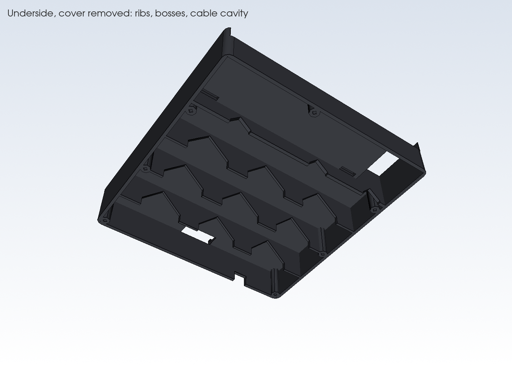
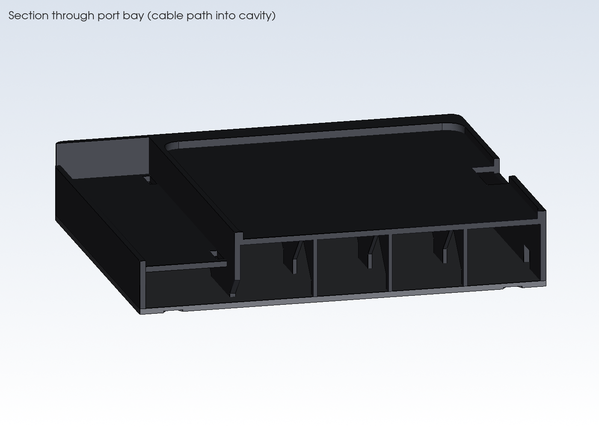
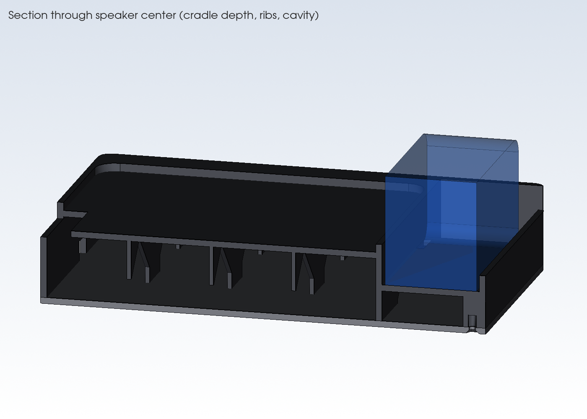

# Kiosk Speaker Plinth

A hollow base for the AboveTEK countertop tablet stand. The stand's base plate sits in a recess on top. An Anker Soundcore 2 sits in a cradle at the front. Its USB and AUX cables stay plugged in, and the splitter and spare cable are hidden inside. One charging cable comes out the back.

## Files (`output/`)
| File | Use |
|---|---|
| `plinth.step` / `.stl` | Main body (top deck, speaker cradle, cable cavity) |
| `bottom_cover.step` / `.stl` | Screw-on bottom cover with rubber-foot recesses |
| `assembly_with_references.step` | Both parts plus see-through reference blocks for the speaker and stand base. Use this to check fit in Onshape. |

**Onshape:** Go to Documents → Import, choose the STEP file, and set units to millimeters. Imported parts come in as plain solids, so make changes in `kiosk_speaker_mount.py` and re-import, or edit the imported part with Onshape features.

## Regenerate
```bash
python3 -m venv .venv && . .venv/bin/activate
pip install -r requirements.txt
python kiosk_speaker_mount.py   # writes output/*.step and *.stl
python render.py                # writes renders/*.png
```
All dimensions are parameters at the top of the script. The checked-in [.vscode/settings.json](.vscode/settings.json) points VS Code at `.venv`.

## Preview
**Live 3D in VS Code:** Install the **OCP CAD Viewer** extension (`bernhard-42.ocp-cad-viewer`). Open the viewer from the Command Palette with *OCP CAD Viewer: Open viewer*, then run [view.py](view.py). After you change a parameter, run `view.py` again; the view updates and keeps your camera angle.

**Static renders:** [render.py](render.py) draws PNG images into [renders/](renders) off-screen. Run it again and commit the images whenever the design changes.

| | | |
|---|---|---|
|  |  |  |
|  |  |  |
|  |  |  |

**Measure these and update them before printing:**
- `STAND_BASE_W/D/T/R`: stand base plate width, depth, thickness, and corner radius. They currently come from the product image (175 × 160 mm).
- `SPK_L/D/H`: speaker length, depth, and height. They currently use the listed 165 × 45 × 54 mm.
- `PORT_END`: which end has the USB/AUX flap when you face the grille. The default is `"right"`.
- `PORT_BAY`: room for the connected plugs. 32 mm assumes right-angle plugs; increase it for straight plugs.
- `STAND_HOLES`: hole positions if you want to bolt the stand through the plinth.

## Project files
| File | Purpose |
|---|---|
| [kiosk_speaker_mount.py](kiosk_speaker_mount.py) | Parametric model and export script |
| [render.py](render.py) | Draws the PNG previews in `renders/` |
| [view.py](view.py) | Sends the model to the OCP CAD Viewer in VS Code |
| [AGENTS.md](AGENTS.md) | Context and conventions for AI agents (Copilot loads it automatically) |
| [SESSION_NOTES.md](SESSION_NOTES.md) | Design decisions, history, and open items |

## Features
- The speaker sits 20 mm deep in the cradle, so the top buttons and the grille stay clear.
- The port bay at the flap end has an open floor, so the cables drop straight into the cavity.
- The cavity is 31 mm tall under the stand and 15 mm tall under the speaker.
- A rear-top notch passes the tablet charging and audio cables. A rear-bottom notch lets the single input cable out.
- Optional strap slots at each end of the speaker, clear of the buttons, take a hook-and-loop strap.
- Internal side-to-side ribs support the top deck. Their pointed-arch openings let cables pass front to back.

## Hardware
- 7 × M3 heat-set inserts (4.0 mm hole, 6 mm deep)
- 7 × M3 × 8 countersunk screws
- 4 × 10 mm stick-on rubber feet
- USB splitter or 2-port charger cable: tablet lead plus Micro-USB lead for the speaker (right-angle Micro-USB recommended)
- Right-angle 3.5 mm AUX cable

## Printing
- Footprint is 206 × 219 mm, so you need a bed of about 220 × 220 mm or larger (a 256 mm bed is comfortable).
- Print the plinth **right side up** (open bottom on the bed) with **no supports**. The ribs limit bridges to about 40 mm under the stand and about 48 mm under the speaker cradle, and the arch openings are self-supporting at 45°.
- Print the cover flat, with the foot recesses down.
- PETG or PLA, 3 walls, 15–20% infill.
